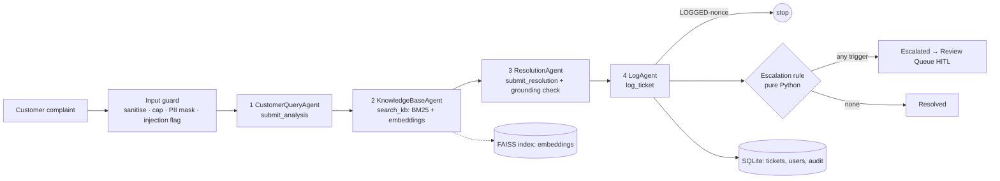

# NovaCart AI Customer Support Desk

A multi-agent support desk built with **AutoGen (v0.7, `autogen-agentchat`)**, Python and Streamlit. Four agents read a complaint, find the answer in the company's own documents, write a grounded reply, and log every ticket, escalating hard cases to a human.

> **Design stance:** the LLM is treated as an *untrusted component*. Facts are produced by deterministic Python (retrieval, escalation rule, log writer) and written to a shared per-run context through validated tool calls. The model decides *wording*, never *what gets logged* or *whether a case is escalated*.

## Architecture



| Agent | Single responsibility | Tool (writes into shared `TicketContext`) |
|---|---|---|
| `CustomerQueryAgent` | category, urgency, sentiment, language, summary | `submit_analysis` (values validated by pydantic) |
| `KnowledgeBaseAgent` | retrieve relevant passages + source file | `search_kb(query)` |
| `ResolutionAgent` | polite reply using *only* retrieved facts + confidence | `submit_resolution` (figures checked against passages) |
| `LogAgent` | persist the row, decide Resolved/Escalated | `log_ticket()` (no LLM-typed facts) |

Order is enforced by `RoundRobinGroupChat` (default) or `SelectorGroupChat` with a deterministic `selector_func` (`TEAM_MODE=selector`). Termination: `TextMentionTermination` on a **per-run random marker** (`LOGGED-<nonce>`) plus `MaxMessageTermination(12)`.

**Forced tool calls.** Each agent has exactly one tool it must call. With AutoGen's default `tool_choice="auto"`, a real model sometimes answers in plain chat text instead, the result never reaches the ticket context, and a good ticket is escalated as "incomplete pipeline" (found in live testing; a scripted test model never does this). `llm_client.RequiredToolClient` wraps the model client and sets `tool_choice="required"` whenever tools are offered (`TOOL_CHOICE=auto` turns it off for providers that reject it). If a model still skips its tool, the ticket fails closed to Escalated.

### Answers carry citations
The Knowledge Base Agent returns numbered passages (`[1] refund_policy.pdf > Return window ...`). The Resolution Agent must put the passage number after every sentence that states a fact, e.g. *"Items can be returned within 30 days of delivery [1]."* `guardrails/citations.py` then checks every marker against what was really retrieved:
- a marker that does not match a retrieved passage (`[9]` when three were returned) is an **invalid citation**;
- a confident answer with **no citation at all** is flagged (`REQUIRE_CITATIONS=false` relaxes this);
- the digits inside markers are not mistaken for factual figures, and invented figures are still caught.
Either problem escalates the ticket (`Reply has missing or invalid citations`). Valid markers are resolved to document and section and stored in the ticket's `citations` column (`[1] refund_policy.pdf › Return window`); staff see them next to the reply, customers see a "Based on" line only for answers they are allowed to see.

### Escalation rule (code, not prompt)
A ticket is **Escalated** if *any* is true: urgency High · customer Angry · no KB document matched · legal threat / fraud / payment dispute (regex backstop over the raw text) · resolution confidence < 0.6 · reply contains figures not in the retrieved passages · missing or invalid citations · possible prompt injection · flagged unsafe by Llama Guard (when enabled) · any pipeline failure. Reasons are stored, e.g. `High urgency + Angry customer + Legal threat`.

## Email input

Customers can also just write an email. `inbox.py` reads the support mailbox (IMAP, or `.eml` files in `data/inbox/` for a demo) and sends each email through the same four agents:

```
email -> filter (robots, own address, duplicates) -> triage -> input guard -> Query -> Knowledge -> Resolution -> Log
      Promotional / Business / General -> polite auto-reply (max one per sender per day), no ticket, agents never run
      Spam -> logged and ignored, no reply
      Resolved  -> grounded, cited answer emailed back in the customer's thread
      Escalated -> acknowledgement emailed now; staff approve/edit the draft in the Review queue and it is emailed then
```

- While the web app runs, the mailbox is checked **automatically** every `MAIL_POLL_SECONDS` (default 60) in a background thread, so new mail is triaged without anyone clicking anything. Set `MAIL_AUTO=false` to turn that off. The *Check mail now* button in the **Email inbox** tab forces an immediate check; `python inbox.py` does one check and `python inbox.py --watch` polls continuously without the web app (don't run it alongside the app, they would both read the same mailbox).
- If the sender's address belongs to a customer account, the ticket appears under that customer's *My requests*.
- Safety: auto-generated, bulk and no-reply mail is ignored and every reply is marked `Auto-Submitted`, so robots cannot loop; a Message-ID is stored once, so a mail is never processed twice; a message is marked read only after its ticket is saved.
- Configure `IMAP_*` (reading) and `SMTP_*` (replying) in `.env`; see `.env.example`. Without them it runs in demo mode: the tab has a *Simulate an incoming email* form and replies are written to `data/outbox/`.

## Voice and photo input

Customers can record a voice message and attach photos on the web form, or send them as email attachments. `media.py` converts them to text first, so the four agents are unchanged: a speech-to-text model transcribes the voice, a vision model describes each photo (damage, labels, order numbers). The text is then guarded like any complaint (PII masked, injection flagged). Types are checked from the file's bytes, not its name; limits: 1 voice message, 3 photos, 10 MB / 5 MB. If an attachment can't be read the ticket is escalated to a human instead of being answered as if it were missing. Audio and photos are sent to your configured STT / vision provider and are not stored; only the text is.

## Voice agent (LiveKit Cloud)

`voice_agent.py` lets a customer talk to a voice agent and raise a ticket by speaking. LiveKit Cloud carries the audio and runs speech-to-text, the conversation model and text-to-speech (LiveKit Inference, billed to your LiveKit plan, no extra provider keys; set `GROQ_API_KEY` to run the conversation and the speech-to-text on Groq instead, `VOICE_GROQ_MODEL` default `openai/gpt-oss-120b`, `VOICE_GROQ_STT` default `whisper-large-v3-turbo`; each has a fallback, see Models and fallbacks). When the agent understands the problem it calls one tool, `raise_ticket`, which runs the same four agents as every other channel (`voice_ticket.py`). A resolved case is answered aloud with the reference number spelled out; an escalated one is acknowledged, and staff handle it in the Review queue (*Voice call* badge, button *Approve (then follow up)*, nothing is sent automatically, so the agent asks for an email or number when the problem is serious).

1. Create a project at cloud.livekit.io and copy `LIVEKIT_URL`, `LIVEKIT_API_KEY`, `LIVEKIT_API_SECRET` into `.env`.
2. `pip install -r requirements-voice.txt`
3. The web app has a **Talk to us** tab (customers and staff): a button that connects the browser's microphone to the agent through `voice_ui.py` and a short-lived token from `voice_token.py` (the API secret never reaches the browser). The voice agent must be running for it to answer. Or `python voice_agent.py console` to talk to it in your terminal, or `python voice_agent.py dev` and open your project's **Agents** page (Agent Console) in LiveKit Cloud. The agent name is `novacart-support` (`VOICE_AGENT_NAME`).

Safeguards: at most 3 tickets per call, a repeated tool call never makes a second ticket, the spoken answer comes only from the grounded reply (no citation markers, the draft of an escalated ticket is never read out), and the speech-to-text output goes through the same input guard as typed text.

## Setup
```bash
python -m venv .venv && source .venv/bin/activate     # Windows: .venv\Scripts\activate
pip install -r requirements.txt
cp .env.example .env                                  # then set OPENAI_API_KEY
python -m auth create --username alice --role staff   # first staff account (creates the SQLite database on first use)
streamlit run app.py
```
No default passwords exist. For a quick demo run `python -m auth seed-demo`, which creates `staff.demo` and `customer.demo` with random one-time passwords printed once. Any OpenAI-compatible provider works via `.env` (`LLM_BASE_URL`, `LLM_MODEL`): OpenAI, Groq, Gemini, Ollama. Docker: `docker compose up --build`.

## Sign-in and access control
Every visitor must sign in; nothing renders for anonymous users.

| | Customer | Staff |
|---|---|---|
| Created by | self sign-up | administrator only (`python -m auth create --role staff`) |
| Can submit a request | yes (name comes from the account) | yes |
| Sees tickets | **only their own** | all (they work the review queue) |
| Sees internal data (escalation reasons, security flags, confidence, unapproved AI drafts) | never | yes |
| Review queue, Ticket log, Dashboard, exports, Audit trail | no | yes |

* **Isolation is enforced in one place.** `auth.tickets_for_user()` filters customers' rows inside the database (other users' tickets are never loaded into memory) and `auth.scope_tickets()` re-checks the result; it is default-deny: an unknown role, a missing owner or a lookalike username returns nothing. The ticket owner is set server-side from the session, never from a form field. Customers get a projection (`auth.customer_view`) that contains no internal field, and an escalated reply is shown only after a staff member approves it.
* **Passwords:** salted scrypt, constant-time comparison, 10-character minimum with a weak-password check, never logged. A sign-up form cannot create staff.
* **Brute force:** 5 failed attempts in 15 minutes lock the account. Attempts are counted in the database *before* the password is hashed, inside one transaction, so a burst of parallel guesses cannot slip past the limit, and the lock survives restarts. Unknown and known usernames get the same message and the same hashing work, so accounts cannot be enumerated. Sign-ups are rate limited.
* **Sessions:** cleared on sign-in and sign-out, expire after 30 idle minutes, and are signed out everywhere when the account's password changes (a per-account password version is checked on every page load).
* **Change password** (Account tab, every user): needs the current password, which is re-checked with the same lockout counting as sign-in, so an unattended signed-in browser cannot be used to guess it. A weak or unchanged password is refused, the account's other sessions are signed out and pending reset links are cancelled.
* **Forgot password** (sign-in page): enter the account's email and an emailed link opens a "choose a new password" page. The link carries a 256-bit random token that is single-use (an atomic database update, so two simultaneous clicks cannot both succeed), expires after 30 minutes and is stored only as a SHA-256 hash, so a leaked database contains no usable links. A newer request cancels older links, requests are rate limited (3 per account per hour, plus a global cap), and a weak new password does not use up the link. The page gives the **same answer for any address**, and the email is sent on a background thread, so neither the text nor the response time reveals which emails have accounts. Completing a reset unlocks a locked account, signs out other sessions and emails a "password changed" notice; changing an account's email notifies the previous address. Email is required at sign-up; existing accounts add one in the Account tab or with `python -m auth set-email`.
* **Sending email:** set `SMTP_HOST` (and `SMTP_PORT`, `SMTP_USER`, `SMTP_PASSWORD`, `SMTP_FROM`, `APP_BASE_URL`, see `.env.example`) to deliver real mail. With no mail server configured the app runs in **demo mode** and saves each email to `data/outbox/` so the whole flow can be tried locally; do not use demo mode in production because that folder contains live reset links.
* **Audit trail** (`audit` table, shown to staff): sign-ins, failures, lockouts, sign-ups, ticket submissions, reviews, ticket views and exports, with no passwords or complaint text. Database triggers reject any UPDATE or DELETE, so history cannot be rewritten through the app.
* **Admin CLI:** `python -m auth create [--email ...] | set-email | passwd | unlock | list | seed-demo`.
* *Limits, stated plainly:* sessions live in Streamlit's server memory, which suits a single-instance desk. Email addresses are not verified when entered (a reset link goes to the address on the account, so protect the account's password), there is no MFA and no SSO; for a larger deployment put an identity provider (`st.login` with OIDC) in front and move SQLite to PostgreSQL. Serve it over HTTPS.

## Knowledge base and retrieval
Five documents in `knowledge_base_pdf/` (shipping, refunds, account/login, product FAQ, billing) with concrete, checkable values (30-day refund window, 5-7 business-day shipping, 12-month warranty, ...). Retrieval is **hybrid**: dependency-free BM25 (coverage-normalised so a threshold can mean "no match") blended 40/60 with embedding cosine similarity. With no embedding endpoint (e.g. Groq) it degrades automatically to BM25 only; the sidebar shows the active mode.
**Vector store: FAISS, and the index is the embedding store** (`kb/vector_index.py`). Each chunk's vector is saved inside the FAISS index under an ID derived from a hash of (provider URL, model, chunk text), so no separate cache, table or JSON file is needed. On restart the index file is loaded and **zero embedding calls** are made; when a document changes, only the new or edited chunks are embedded and the old vectors are reconstructed straight out of the index; changing the model or provider re-embeds everything, never mixing vectors. Vectors are unit-normalised, so inner product equals cosine. Small knowledge bases use `IndexFlatIP` (exact search); from 2,000 passages up it switches to `IndexHNSWFlat` (approximate, scales to millions). The index is written atomically under `.cache/`; a corrupt file is rebuilt. If `faiss-cpu` is missing or errors, search falls back to numpy (not persisted), and if embeddings are unavailable it falls back to BM25 only. Control it with `VECTOR_BACKEND=faiss|numpy`. ChromaDB was not used because it has no reliable wheels for the newest Python and adds a server-style dependency for no gain at this size.
**Caching:** three layers keep embedding calls down. (1) The FAISS index above is the on-disk cache of chunk embeddings. (2) The loaded knowledge base (chunks, BM25, index) is kept in memory for the whole process and reloaded only when a document or the retrieval settings change. (3) Query embeddings are memoised in memory (`kb/embeddings.py`, the 256 most recent queries), so an identical repeated question makes no embedding call; this cache is lost on restart. Model answers (triage, agents, speech-to-text, image descriptions) are deliberately not cached, because replies depend on the customer, their order and the current policy.
*Why no reranker:* a reranker is a second model that re-scores the top passages. It is not used because the knowledge base is five short documents, where hybrid retrieval already puts the right passage in the top 3, it would add a model call (cost and delay) to every ticket, and weak matches already escalate to a human while citations are verified. It becomes worthwhile with hundreds of documents or if `python -m evals.run_rag_eval --embeddings` shows the right passage often missing from the top 3.
*Why not Neo4j:* a graph database pays off when answers depend on relationships between entities (orders, customers, products, policies). This knowledge base is a small set of prose policies, where vector plus keyword retrieval is the right tool. A graph layer would be a sensible next step if you add structured order and customer data.

### PDF knowledge base
Each document is its own PDF in `knowledge_base_pdf/`, which is the active knowledge base (set `KB_DIR` to point elsewhere). The loader reads `.pdf`, `.md` and `.txt`, recovering section headings from font size. `tools/build_kb_pdfs.py` regenerates PDFs from Markdown sources if you keep any in `knowledge_base/`. Scanned/image-only PDFs have no text layer and would need OCR.

## Security and guardrails
| Threat | Control |
|---|---|
| Prompt injection in complaint | pattern detector → flagged + escalated; complaint wrapped in unguessable-delimiter data block; delimiters stripped from input; the log tool accepts **no** LLM-authored facts |
| Paraphrased or multilingual attacks the patterns miss | optional **Llama Guard** safety classifier on the message (see below); an unsafe verdict escalates |
| Early termination by typing `LOGGED` | per-run random termination marker |
| CSV/Excel formula injection | text is stored faithfully; leading `= + - @` is neutralised on every CSV/Excel **export** |
| SQL injection | parameterised queries only; payloads are stored as literal text (tested) |
| PII leakage | Luhn-validated card numbers, emails, phones masked before the LLM and the log |
| Secret leakage | key only from `.env` (gitignored); replies/errors scrubbed for key-like strings; UI never shows the key |
| Hallucinated policy | grounding check: any number not in retrieved passages lowers confidence and forces escalation |
| Abuse / cost | 2000-char cap, per-session rate limit, LLM timeout + retries, message cap |
| Data integrity | SQLite in WAL mode with durable commits, foreign keys, STRICT tables and CHECK constraints; every write is one `BEGIN IMMEDIATE` transaction (safe across threads and processes); ticket IDs are generated by the database; ticket identity fields (owner, complaint, time) are immutable and the audit table is append-only (triggers); a database from a newer app version is refused |
| LLM outage / bad tool use | **fail closed**: a ticket is always logged, as Escalated |

### Why custom guardrails plus an optional Llama Guard (not NeMo Guardrails)
- **Deterministic rules own the decision.** Grounding, citations, escalation and the log row are plain Python in `guardrails/`: exact checks that run offline, add no latency or model calls, and cannot be talked around by a jailbroken model. They are covered by the offline test suite and measured by the evals.
- **No NeMo Guardrails.** It is a conversation-flow framework (Colang). It adds a heavy dependency and usually extra LLM calls per message, and this app has no free-form dialogue to steer: every ticket follows one fixed pipeline.
- **Llama Guard adds what regex cannot.** The injection detector is a pattern list, so a reworded or non-English attack can slip past it. Llama Guard is a safety classifier model that judges meaning in any language. It is a second, independent layer, never the only one.
- **It can only add a flag.** An unsafe verdict escalates the ticket to a human with the violated categories logged; it never auto-resolves or blocks silently. If the guard is configured but unreachable, the ticket is escalated too (fail closed).
- **Off by default, no vendor lock-in.** Set `GUARD_MODEL` (and `GUARD_BASE_URL`) to any OpenAI-compatible host: Groq `meta-llama/llama-guard-4-12b`, or local Ollama `llama-guard3`. It costs one short call per ticket, so the trade-off is a little latency and money for broader coverage.
- **Scope.** It screens the customer's message. The reply is already constrained by the grounding and citation checks, which are stricter than a generic safety classifier for this use.

## Human in the loop
Escalated tickets are stored with `review_status=Pending` and an AI-drafted reply. The **Review Queue** tab lets a support person approve, edit-and-approve, or reject; the decision, final reply, reviewer and time are written back to the ticket. A ticket can be reviewed only once, so two reviewers cannot silently overwrite each other. *Note:* this is an asynchronous queue rather than AutoGen's `UserProxyAgent`, because a Streamlit rerun cannot block waiting on input mid-run.

## Storage
Everything lives in one SQLite file, `data/support.db` (`DB_PATH`), except the FAISS index and the knowledge-base PDFs.

| Data | Where |
|---|---|
| Accounts (salted password hashes, email) | `users` table |
| Password-reset links (hashed tokens only) | `password_resets` table |
| Tickets, AI reply, review result | `tickets` table (`ticket_id, timestamp, owner, customer_name, order_id, complaint, category, urgency, sentiment, language, kb_sources, citations, response, confidence, status, escalation_reason, security_flags, review_status, final_response, reviewed_by, reviewed_at`) |
| Audit trail | `audit` table (append-only) |
| Login throttling | `login_failures` table |
| Embeddings | inside the FAISS index, `.cache/kb_vectors.faiss` |
| Knowledge base | `knowledge_base_pdf/*.pdf` |

```bash
python -m db init                # create/upgrade the schema (also happens automatically on first use)
python -m db check               # integrity check, foreign keys, journal mode, row counts
python -m db backup backups/x.db # consistent online backup, safe while the app is running
python -m db migrate-legacy      # one-time import of the old users.json / tickets.csv / audit.csv (originals renamed *.migrated)
```
The schema is versioned (`PRAGMA user_version`) with ordered migrations in `db.py`. Back up `data/` and `.cache/`; the Docker compose file mounts both. SQLite suits a single app server. For several servers move the same schema to PostgreSQL; all SQL is confined to `db.py`, `logstore.py`, `audit.py` and `auth.py`.

## Models and fallbacks
Every model the project uses, what it does, and what takes over when it is not available. Defaults are shown; each can be changed in `.env` (see `.env.example`).

| Job | Default model | Setting | Fallback |
|---|---|---|---|
| Writes the customer's reply (ResolutionAgent) | `gpt-4o-mini` (OpenAI) | `LLM_MODEL`, `OPENAI_API_KEY` | none, a key is required |
| Triage, query analysis, knowledge-base agent, log agent | `deepseek-chat` (DeepSeek) | `FAST_MODEL`, `DEEPSEEK_API_KEY` | the main model, `gpt-4o-mini`, when there is no key and also for any single call that fails at run time |
| Embeddings for semantic search | `text-embedding-3-small` (OpenAI) | `EMBEDDING_MODEL` | keyword (BM25) search only |
| Speech to text for uploaded audio and Telegram voice notes | `whisper-large-v3-turbo` (Groq) | `STT_MODEL`, `STT_BASE_URL`, `STT_API_KEY` | OpenAI `whisper-1` when a Groq call fails; without a Groq key `whisper-1` is the main model |
| Photo description | `gpt-4o-mini` (the main model) | `VISION_MODEL` | none |
| Live voice: speech to text | `whisper-large-v3-turbo` (Groq) | `VOICE_GROQ_STT`, `VOICE_STT_LANGUAGE` | Deepgram `nova-3` through LiveKit |
| Live voice: conversation (Nova) | `openai/gpt-oss-120b` (Groq) | `VOICE_GROQ_MODEL`, `GROQ_API_KEY` | LiveKit Inference `google/gemma-4-31b-it` (`VOICE_LLM`) |
| Live voice: text to speech | Inworld `inworld-tts-2`, voice Ashley | set in `voice_agent.py` | LiveKit Inference `fishaudio/s2.1-pro` (`VOICE_TTS`) |
| Optional safety screen | none (off) | `GUARD_MODEL` | none |

How the fallbacks behave:
- **Text pipeline:** the fast model runs behind `FallbackClient` (`llm_client.py`). If a call to it fails for any reason (outage, rate limit, bad key, timeout) that one call is repeated on the main model, so the ticket is not lost. A half-delivered streamed answer is never restarted, and cancellation is never swallowed. Only the pipeline's own errors still escalate a ticket for staff.
- **Uploaded audio:** if Groq transcription fails and an OpenAI key exists, the same file is sent to OpenAI `whisper-1`.
- **Live voice:** speech to text, conversation and text to speech are LiveKit `FallbackAdapter` chains, so a failing provider is replaced mid-call by the next one.
- **Not covered:** a model that answers but returns something unusable (for example plain text instead of a tool call) is not a failure, so it does not trigger a fallback. The pipeline's checks and the escalation rule still apply.
- **Model names change:** providers retire models (Groq removed `llama-3.3-70b-versatile`). If a call fails with a 404, list what your key can use, for example `curl https://api.groq.com/openai/v1/models -H "Authorization: Bearer $GROQ_API_KEY"`, and set the new name in `.env`.

## Speed and cost
Three of the four agents only fill in a form or trigger a tool, so they run on a fast, cheap model (`DEEPSEEK_API_KEY`, `FAST_MODEL`, default `deepseek-chat`): triage, the query agent, the knowledge-base agent and the log agent. The Resolution agent, which writes the customer's reply, keeps the main model. Without a fast key everything uses the main model, and with one, any call that fails on the fast model is retried on the main model (see Models and fallbacks). Complaint text is sent to the fast provider too, so check that its data terms suit you. A burst of mail or chat messages is worked on `MAX_PARALLEL` (default 3) at a time.

Measure it on your own keys with `python -m evals.latency --n 6 --parallel 3` (real API calls, throw-away database). Measured on this project (main model `gpt-4o-mini`, six sample complaints, one network location, so treat the numbers as indicative):

| | Main model for everything | Fast model for the three steps |
|---|---|---|
| Triage call | 1.09 s | 0.81 s |
| Whole ticket, median | 7.4 s | 5.8 s |
| Whole ticket, slowest of 6 | 10.6 s | 8.5 s |
| 3 tickets at once | 6.4 s wall clock | 5.7 s wall clock |

The reply-writing step (about 2.6 s) is now the largest share of a ticket. Quality check: the same sample complaints were resolved or escalated exactly as before (4 resolved, 2 escalated in both runs).

## Measuring retrieval and hallucination
Two evaluations run on a hand-labelled **gold set** (`evals/rag_gold.yaml`: 34 answerable questions in natural wording, each labelled with the section(s) that answer it, plus 6 questions the knowledge base cannot answer).

```bash
python -m evals.run_rag_eval                 # retrieval, keyword mode: offline and free
python -m evals.run_rag_eval --embeddings    # retrieval, hybrid BM25 + embeddings + FAISS (embeds the 40 questions)
python -m evals.run_generation_eval          # live: full pipeline + claim-level hallucination judge (about 80 model calls)
```
**Retrieval** is scored per question at k = 3 (the passages the Resolution Agent receives): precision@1, precision@3, recall@3, hit rate, MRR, nDCG, and *abstention* (do unanswerable questions retrieve nothing?). **Hallucination** is measured by extracting every factual claim from each reply and checking, strictly, whether the passages the agent actually retrieved support it: *claim-level rate* = unsupported claims / all claims, *response-level rate* = replies with any unsupported claim. It also reports citation validity and coverage, and whether unanswerable questions were escalated without an invented fact. The judge is itself an LLM (`JUDGE_MODEL`), so treat the result as a strong signal, not ground truth; the gold set is small and written by the author, so the retrieval numbers are a regression gauge, not a benchmark. Latest reports: `evals/rag_retrieval_report.md`, `evals/rag_generation_report.md`.

Measured on the 34 + 6 gold questions:

| Retrieval (k = 3) | Keyword (BM25) | Hybrid (BM25 + embeddings, FAISS) |
|---|---|---|
| Precision@1 | 67.7% | **97.1%** |
| Recall@3 | 79.4% | **95.6%** |
| Hit rate@3 | 82.3% | **97.1%** |
| MRR | 0.750 | **0.971** |
| nDCG@3 | 0.742 | **0.957** |
| Abstention on the 6 unanswerable questions | 3/6 | 4/6 |

| Answer quality (live, `gpt-4o-mini`, hybrid) | Result |
|---|---|
| Claim-level hallucination rate | **0.0%** (0 of 87 claims unsupported) |
| Response-level hallucination rate | **0.0%** |
| Replies with claims that carry a validated citation | 100% (34 of 34) |
| Answerable questions resolved without escalation | 33/34 (the miss is a chargeback question, escalated on purpose as a payment dispute) |
| Unanswerable questions escalated with no invented fact | 6/6 |

One earlier run flagged 1 of 79 claims; on inspection it was a judge error (the fact was in a retrieved passage). Results vary a little run to run, and the LLM judge can be wrong in either direction, so spot-check `evals/rag_generation_report.md`.

Known weak spots, kept visible on purpose: "Is shipping free?" misses its section in both modes, and dense retrieval still returns weakly related passages for some out-of-scope questions ("Who is the CEO of NovaCart?", "student discount"). Retrieval abstention is therefore not relied on alone: the Resolution Agent must say it has no information when passages do not answer the question, low confidence escalates, and the generation evaluation measures whether that works end to end.

## Tests and evals
```bash
python -m pytest -q                          # offline tests (scripted model, no key needed)
python -m evals.run_evals --offline          # retrieval + rules on the 10 cases
python -m evals.run_evals                    # live, end to end; writes evals/report.md
```
Offline tests cover the escalation truth table, retrieval for the six assignment complaints, injection/PII/CSV/secret guards, concurrent writers across threads and processes, SQLite constraints, tamper-protection triggers and SQL injection, backup and legacy import, FAISS persistence and incremental embedding, the full four-agent run (order, termination, fail-closed, selector mode), and the Streamlit UI driven headlessly, including sign-in, lockout, role separation and customer-to-customer data isolation.
Evals: the six required complaints from the assignment + four of ours (prompt injection, Spanish refund, gibberish, off-topic).
Live results with `gpt-4o-mini`, forced tool calls and the PDF knowledge base: 10/10 in the latest run (`evals/report.md`). Across repeated runs the one case that occasionally flips is "Where is my order?", which the desk sometimes escalates when the model reports low confidence; model output is not perfectly deterministic, and escalating when unsure is the safe direction. Run `python -m evals.run_evals` yourself with your key to reproduce.
Run the app with the same Python environment you installed `requirements.txt` into (for example `venv\Scripts\python -m streamlit run app.py`); if `faiss-cpu` is missing there, the sidebar shows an orange "Hybrid · numpy (no FAISS)" badge with the reason.

## Screenshots
Add your own after running with your key (`screenshots/`): a Resolved ticket, an Escalated ticket, the Ticket Log, and the two extra test cases.

## Project layout
`app.py` UI (sign-in, submit form, customer view) · `staff_ui.py` staff tabs (review queue, ticket log, dashboard, audit trail, email inbox) · `auth.py`/`auth_ui.py`/`audit.py` accounts, sign-in gate, audit trail · `team.py` team wiring · `agents/` the four agents · `kb/` retrieval · `guardrails/` input/output/escalation/CSV safety · `db.py`/`logstore.py`/`legacy_import.py` SQLite storage, tickets and review · `evals/` · `tests/`.

## Telegram

Free and the easiest live channel: no public URL, no business verification. Customers message your bot with text, a voice note or a photo and the same four agents handle it (resolved: answered in the chat; escalated: acknowledged, then staff approve the draft in the Review queue and it is sent to the chat; greetings, promos and spam: friendly reply or none, no ticket).

1. In Telegram open `@BotFather`, send `/newbot`, pick a name and a username ending in `bot`, and copy the token.
2. Put `TELEGRAM_BOT_TOKEN=<token>` (and `OPENAI_API_KEY`, plus the STT/vision settings for voice and photos) in `.env`.
3. Run `python telegram_bot.py`, open your bot in Telegram and send a message.

Only private chats are served. Each chat is limited to 20 messages an hour.
